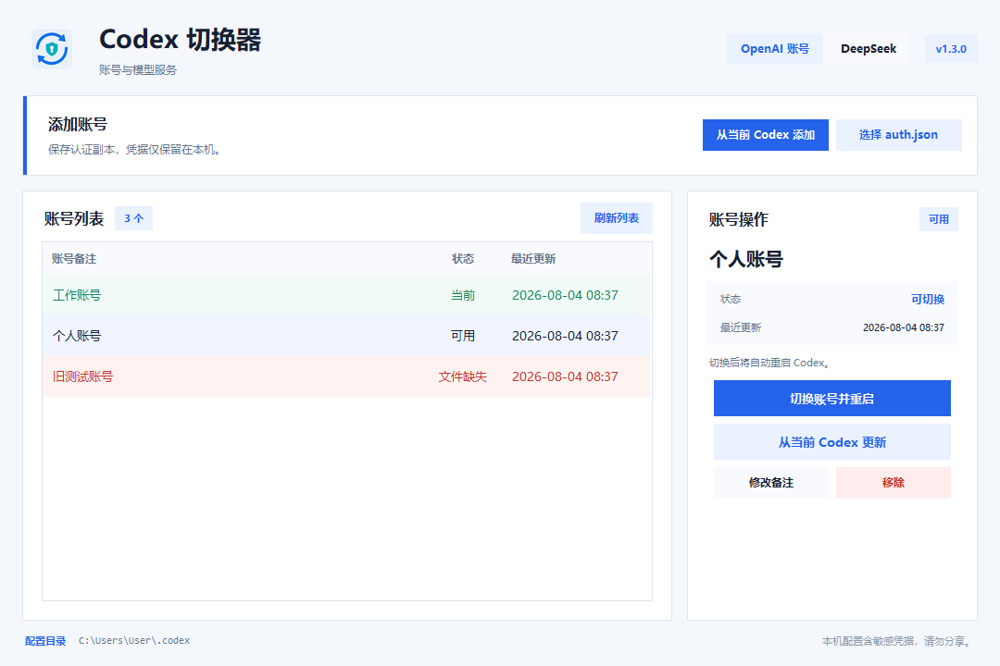

# Codex 切换器

Codex 切换器是一款仅在本机运行的 Windows 桌面工具，用于管理 Codex 的 OpenAI 账号认证，并在 OpenAI 与 DeepSeek 之间安全切换。

> 本项目是非官方辅助工具，不隶属于 OpenAI 或 DeepSeek。程序不会修改 Codex 客户端安装文件。



## 功能

- 从当前 Codex 或指定的 `auth.json` 添加 OpenAI 账号。
- 更新认证副本、修改备注、移除账号并保留必要备份。
- 切换 OpenAI 账号后自动重启 Microsoft Store 版 Codex。
- 切换到 DeepSeek V4 Flash，并精确恢复切换前的 OpenAI 配置。
- DeepSeek 模式下可直接切换 OpenAI 账号，一次完成服务恢复、账号替换和客户端重启。
- 检测受管配置的外部修改；存在冲突时停止覆盖。
- 配置写入失败时回滚 `config.toml`、`models.json` 和账号认证文件。

## 安全设计

- 账号认证副本仅保存在 EXE 同级的“账号文件”目录。
- DeepSeek API Key 保存在 Windows 凭据管理器，界面只显示末四位。
- 模型服务恢复状态使用当前 Windows 用户的 DPAPI 加密。
- 配置和认证文件采用临时文件、落盘同步和原子替换。
- 仓库检查会拒绝认证文件、私钥、疑似 API Key、运行时数据和构建产物。
- 发布包不会包含本机账号数据、Codex 配置或 Windows 凭据。

使用 DeepSeek 期间，Codex 会按官方配置要求从 `%USERPROFILE%\.codex\config.toml` 读取 API Key；切回 OpenAI 后，本程序会移除受管的 DeepSeek 配置并恢复原状态。

## 环境要求

- Windows 10 或 Windows 11（64 位）。
- 自动重启功能需要 Microsoft Store 版 Codex。
- 直接运行源码或构建时需要 Python 3.8；项目默认使用 `C:\venv`，不会调用全局 Python。

## 快速开始

### 运行源码

```powershell
& "C:\venv\Scripts\python.exe" -m pip install -r ".\requirements-dev.txt"
& "C:\venv\Scripts\python.exe" ".\app.py"
```

### 构建 EXE

```powershell
& ".\build.ps1"
```

构建结果位于 `dist\Codex账号切换器.exe`。构建脚本会先执行仓库安全检查、图标生成和全部自动化测试。

### 创建交付包

```powershell
& ".\release.ps1"
```

发布脚本会生成带使用说明和 SHA-256 校验文件的 ZIP，输出到 `release\`。已有同名输出不会被覆盖；确认需要替换时显式传入 `-Force`。

## 质量检查

```powershell
& "C:\venv\Scripts\python.exe" -m ruff check "."
& "C:\venv\Scripts\python.exe" -m ruff format --check "."
& "C:\venv\Scripts\python.exe" -m unittest discover -s ".\tests" -v
& "C:\venv\Scripts\python.exe" ".\tools\repository_check.py"
```

GitHub Actions 会在 Windows 环境中重复执行静态检查、格式检查、测试、仓库安全检查和 PyInstaller 构建。

## 项目结构

```text
.
├── app.py                    # Tkinter 界面与交互编排
├── account_store.py          # 账号认证存储与事务回滚
├── codex_client.py           # Microsoft Store Codex 重启边界
├── credential_store.py       # Windows 凭据管理器与 DPAPI
├── provider_config.py        # OpenAI / DeepSeek 配置事务
├── assets/                   # 图标源文件与固定模型目录
├── docs/                     # 用户、架构、构建与发布文档
├── packaging/                # 发布包内的纯文本说明
├── tests/                    # 自动化测试
├── tools/                    # 仓库检查、视觉检查与 EXE 冒烟测试
├── build.ps1                 # 可复现 EXE 构建
└── release.ps1               # 可复现交付 ZIP 构建
```

## 兼容性与限制

- 当前自动重启仅适用于 Microsoft Store 版 Codex；其他安装方式需要手动重启。
- 截至 2026-08-04，[DeepSeek 官方 Codex 接入文档](https://api-docs.deepseek.com/zh-cn/quick_start/agent_integrations/codex/)仍仅明确支持 `deepseek-v4-flash`，因此界面不会提前开放 `deepseek-v4-pro`。
- 发布的 EXE 未使用商业代码签名证书，Windows 首次运行时可能显示安全提示。
- 本项目不会联网验证 API Key；真实调用可能产生费用，由用户自行确认。

## 文档

- [使用指南](docs/USER_GUIDE.md)
- [架构与安全边界](docs/ARCHITECTURE.md)
- [构建说明](docs/BUILDING.md)
- [发布验收清单](docs/RELEASE_CHECKLIST.md)
- [当前源码验收记录](docs/VERIFICATION.md)
- [贡献指南](CONTRIBUTING.md)
- [安全策略](SECURITY.md)
- [第三方资料说明](THIRD_PARTY_NOTICES.md)

## 许可证

本仓库当前未附加开源许可证。未经著作权人明确授权，不得复制、修改或再分发本项目源码。若计划将仓库作为开源项目公开发布，请先选择并补充合适的许可证。
