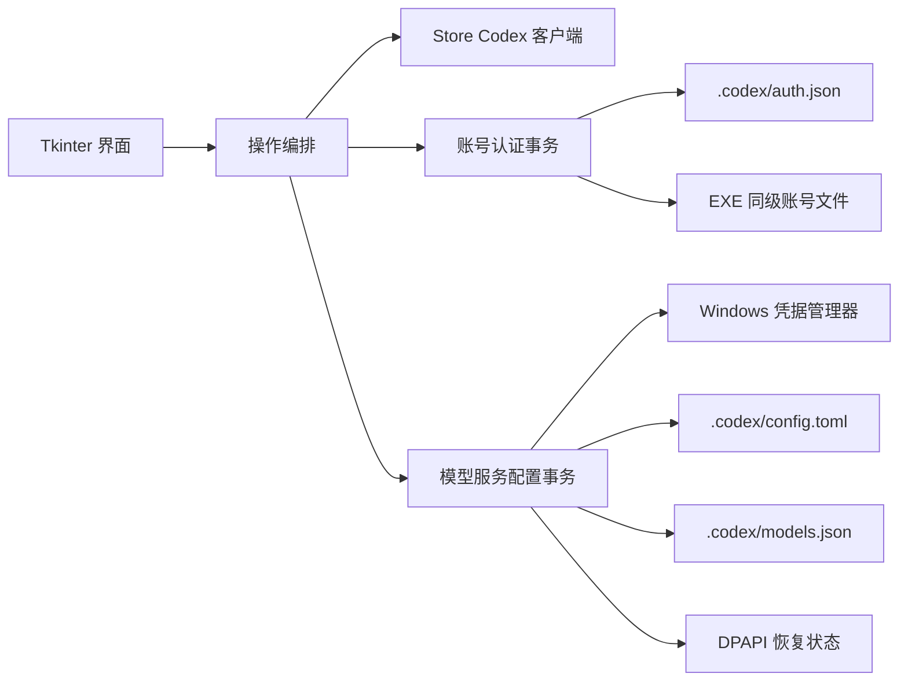

# 架构与安全边界

## 设计目标

Codex 切换器是单机 Windows 应用。设计优先级依次为：不泄露凭据、不破坏现有 Codex 配置、失败可回滚、用户操作明确、打包后无需 Python 环境。

## 模块职责

| 模块 | 职责 | 不负责 |
| --- | --- | --- |
| `app.py` | Tkinter 界面、状态展示、后台任务和用户确认 | 直接实现磁盘事务或 Win32 底层调用 |
| `account_store.py` | 认证文件校验、最小账号身份指纹、账号清单、原子复制、备份和回滚 | 解析令牌声明、刷新令牌或联网验证账号 |
| `provider_config.py` | DeepSeek 配置激活、冲突检测、恢复状态和多文件回滚 | 保存 API Key 的长期明文副本 |
| `credential_store.py` | Windows 凭据管理器和 DPAPI | 管理 Codex 账号认证文件 |
| `codex_client.py` | 识别、关闭和启动 Microsoft Store 版 Codex | 操作其他 Codex 安装或无关进程 |
| `tools/repository_check.py` | 提交前的仓库内容、安全和完整性检查 | 替代 GitHub Secret Scanning 或密钥轮换 |

## 核心流程

### 切换 OpenAI 账号

1. 按固定顺序取得目标认证锁和账号存储锁；同一进程可重入，其他进程必须等待或超时退出。
2. 在锁内重新读取模型服务状态并检查配置冲突，避免基于加锁前的过期状态继续切换。
3. 请求 Microsoft Store 版 Codex 退出；必要时仅终止匹配 Store 包路径的进程。
4. 读取当前认证的 `auth_mode` 与 `tokens.account_id`，计算只存在于内存中的 SHA-256 身份指纹。
5. 如果身份唯一匹配已保存账号、原副本哈希可信且 Codex 已更新文件，则以清单哈希作为预期旧版本，备份并复检旧副本后原子保存当前认证，同时更新清单哈希。
6. 校验目标账号副本与清单 SHA-256 一致，备份并复检当前 `auth.json`；目标副本先复制到同目录临时文件并通过预期源哈希校验，再原子替换当前认证。
7. 验证目标文件哈希并重新启动 Codex，随后释放完整事务锁。
8. 若账号替换失败，只有在目标仍能证明是本次写入内容时才恢复原认证，并尝试重新启动客户端；已经安全保存的刷新认证不降级回旧副本。若目标已再次变化，则保留现场与备份、拒绝覆盖并提示人工处理。

当 DeepSeek 正在使用时，流程在保存当前认证后先替换目标账号，再恢复 OpenAI 受管配置，最后启动 Codex；恢复失败会回滚刚完成的账号替换并按已完成阶段执行补偿。

### ChatGPT 认证自动同步

Codex 官方客户端负责登录、令牌刷新、失效判断和将新令牌回写到 `.codex/auth.json`。本应用不实现 OAuth 客户端，也不依赖固定刷新周期。

保存的账号副本与当前文件可能因为正常令牌轮换而拥有不同 SHA-256。为区分“同一账号的正常刷新”和“另一个账号或外部篡改”，应用在完成 JSON 结构校验后只提取并使用：

- 顶层 `auth_mode`，且仅对 `chatgpt` 托管认证启用自动同步。
- `tokens.account_id`，经过带域分隔符的 SHA-256 后用于本次进程内匹配。

应用不解码 JWT，不读取令牌声明，不输出原始账号 ID，也不把身份指纹写入 `profiles.json`。自动同步必须同时满足：

1. 当前认证结构有效。
2. 恰好一个可信账号副本具有相同身份。
3. 该副本当前哈希仍等于清单记录，未被外部修改。
4. Codex 已完全停止，源文件不会继续被官方客户端写入。
5. 从身份判断到写入前，清单和副本仍保持同一预期旧哈希；备份完成后再复检一次。

身份重复、身份错配、认证模式冲突、源文件在复制中变化或清单写入失败都会停止操作。副本更新沿用“更新备份”和原子替换；后续账号替换仍使用独立的“切换备份”，因此两个阶段可以分别审计和恢复。

为避免并发写入，应用不在 Codex 运行期间启动后台监视器。账号清单变更使用 EXE 数据目录内的 `.profiles.lock`；完整账号切换和模型服务切换共用目标 `.codex` 目录内的 `.codex-account-switcher.lock`，因此不同程序实例不会交叉停止/启动 Codex，账号线程也会在持锁后重新确认模型服务状态。账号切换结合进程内可重入锁，并始终按“目标锁 → 存储锁”的顺序取得。锁是协作式保护；判断、临时副本源哈希校验、备份、替换、失败恢复和后续回滚阶段的多次哈希比较会检测在这些检查点暴露的外部写入，无法证明目标仍是本次写入内容时不会用旧备份覆盖。但独立锁文件无法强制任意第三方进程遵守，也不构成文件系统级原子比较交换。Codex 刷新后的文件会立即通过身份匹配显示为当前账号，并在下一次可能覆盖 `auth.json` 的切换操作前可靠保存。

### 切换到 DeepSeek

1. 从 Windows 凭据管理器读取并校验 API Key。
2. 读取现有 `config.toml` 和 `models.json`，拒绝过大、非法 UTF-8 或非法 TOML/JSON。
3. 将恢复基线使用当前 Windows 用户的 DPAPI 加密后写入 `provider_state.dat`。
4. 生成仅包含官方要求字段的配置变更，并写入固定哈希的模型目录。
5. 任一文件写入失败时恢复全部原值；成功后重新启动 Codex。

### 切回 OpenAI

应用对当前受管字段和模型目录计算语义指纹。如果这些内容被外部程序修改，应用停止恢复并提示冲突，不会猜测或覆盖。验证通过后，仅恢复本应用接管的字段，并保留切换后新增的 MCP、插件、项目配置等非受管内容。

## 数据与信任边界

- `auth.json` 和账号副本属于高敏感凭据；应用只做结构、大小、哈希、认证模式和稳定账号身份匹配，不解释、记录或上报令牌内容。
- DeepSeek API Key 的持久存储由 Windows 凭据管理器负责；使用 DeepSeek 期间，Codex 官方配置仍需要在 `config.toml` 中读取该值。
- `provider_state.dat` 只用于同一 Windows 用户恢复配置，不能跨用户或跨设备解密。
- 模型目录来自固定的官方快照并由 SHA-256 约束；更换快照必须同步更新来源说明、常量和测试。
- 应用没有遥测、更新检查或后台网络请求。

## 兼容性约束

- 目标平台为 Windows 10/11 64 位。
- 自动重启边界只匹配 Microsoft Store 包路径和固定 AUMID。
- 账号存储格式继续使用清单版本 1，向后兼容 v1.0.x 至 v1.3.x；缺少 `updated_at` 的旧记录在读取时迁移。旧认证结构仍可读取、添加、切换和移除，同模式 API Key 及两侧均非 ChatGPT 的旧格式仍可手动更新，但只有当前 Codex 托管 ChatGPT 格式启用自动同步；缺少可验证身份的旧 ChatGPT 记录不能用变化后的 ChatGPT/API Key 认证覆盖，需重新添加。
- 自动同步只面向 Codex 实际回写到 `.codex/auth.json` 的文件凭据；操作系统凭据存储中未落入该文件的认证不在应用信任边界内。
- 代码保持 Python 3.8 语法兼容，PyInstaller 生成单文件 GUI 应用。
