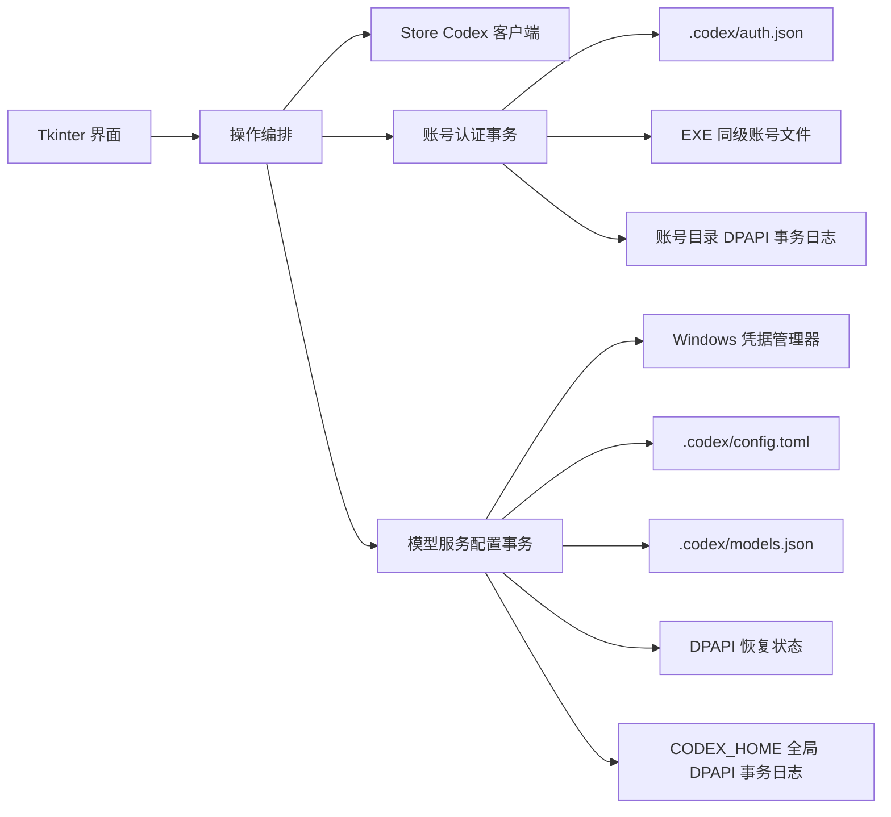

# 架构与安全边界

## 设计目标

Codex 切换器是单机 Windows 应用。设计优先级依次为：不泄露凭据、不破坏现有 Codex 配置、失败可回滚、用户操作明确、打包后无需 Python 环境。

## 模块职责

| 模块 | 职责 | 不负责 |
| --- | --- | --- |
| `app.py` | Tkinter 界面、状态展示、后台任务和用户确认 | 直接实现磁盘事务或 Win32 底层调用 |
| `account_store.py` | 认证文件校验、最小账号身份指纹、DPAPI 持久账号存储事务、原子复制、备份和恢复 | 解析令牌声明、刷新令牌或联网验证账号 |
| `provider_config.py` | DeepSeek 模型白名单、配置激活、冲突检测、DPAPI 持久事务日志、恢复状态和多文件比较更新/回滚 | 保存 API Key 的长期明文副本 |
| `credential_store.py` | 按 `CODEX_HOME` 隔离的 Windows 凭据、v1.4 迁移、活动配置对账和 DPAPI | 管理 Codex 账号认证文件 |
| `codex_client.py` | 识别、关闭和启动 Microsoft Store 版 Codex | 操作其他 Codex 安装或无关进程 |
| `tools/repository_check.py` | 提交前的仓库内容、安全和完整性检查 | 替代 GitHub Secret Scanning 或密钥轮换 |

## 核心流程

### 切换 OpenAI 账号

1. 按固定顺序取得目标认证锁和账号存储锁；同一进程可重入，其他进程必须等待或超时退出。
2. 在锁内重新读取模型服务状态并检查配置冲突，避免基于加锁前的过期状态继续切换。
3. 请求 Microsoft Store 版 Codex 退出；必要时仅终止匹配 Store 包路径的进程。
4. 读取当前认证的 `auth_mode` 与 `tokens.account_id`，计算只存在于内存中的 SHA-256 身份指纹。
5. 如果身份唯一匹配已保存账号、原副本哈希可信且 Codex 已更新文件，则以清单哈希作为预期旧版本，备份并复检旧副本后原子保存当前认证，同时更新清单哈希。
6. 校验目标账号副本与清单 SHA-256 一致，备份并复检当前 `auth.json`；目标副本先复制到同目录临时文件并通过预期源哈希校验，再原子替换当前认证。
7. 验证目标文件哈希并重新启动 Codex，随后释放完整事务锁。
8. 若账号替换失败，只有在目标仍能证明是本次写入内容时才恢复原认证，并尝试重新启动客户端；已经安全保存的刷新认证不降级回旧副本。若目标已再次变化，则保留现场与备份、拒绝覆盖并提示人工处理。

当 DeepSeek 正在使用时，流程在保存当前认证后先替换目标账号，再恢复 OpenAI 受管配置，最后启动 Codex；恢复失败会回滚刚完成的账号替换并按已完成阶段执行补偿。

账号副本与 `profiles.json`/清单备份的导入、更新、移除、重命名和清单修复使用独立的 `.codex-account-switcher-account-transaction.dat`。日志整体由当前 Windows 用户的 DPAPI 保护，只允许当前“账号文件”绝对路径、一个严格 `auth_<32hex>.json` 目标和固定的主清单/清单备份目标。它保存事务前完整字节与事务后存在状态、长度、SHA-256；每次取得账号存储锁后都会先恢复。全部目标为 after 时确认提交，全部为 before 时清理日志，混合状态按相反顺序恢复；第三态不覆盖并保留日志失败关闭。旧版 `.remove` 墓碑只有在有效主清单能证明账号仍存在或已经移除时才恢复/清理，来源与墓碑同时存在且内容冲突时不会猜测。

### ChatGPT 认证自动同步

Codex 官方客户端负责登录、令牌刷新、失效判断和将新令牌回写到 `.codex/auth.json`。本应用不实现 OAuth 客户端，也不依赖固定刷新周期。

保存的账号副本与当前文件可能因为正常令牌轮换而拥有不同 SHA-256。为区分“同一账号的正常刷新”和“另一个账号或外部篡改”，应用在完成 JSON 结构校验后只提取并使用：

- 顶层 `auth_mode`，且仅对 `chatgpt` 托管认证启用自动同步。
- `tokens.account_id`，经过带域分隔符的 SHA-256 后用于本次进程内匹配。

应用不解码 JWT，不读取令牌声明，不输出原始账号 ID，也不把身份指纹写入 `profiles.json`。自动同步必须同时满足：

1. 当前认证结构有效。
2. 恰好一个可信账号副本具有相同身份。
3. 该副本当前哈希仍等于清单记录，未被外部修改。
4. Codex 已完全停止，源文件不会继续被官方客户端写入。
5. 从身份判断到写入前，清单和副本仍保持同一预期旧哈希；备份完成后再复检一次。

身份重复、身份错配、认证模式冲突、源文件在复制中变化或清单写入失败都会停止操作。副本更新沿用“更新备份”和原子替换；后续账号替换仍使用独立的“切换备份”，因此两个阶段可以分别审计和恢复。

为避免并发写入，应用不在 Codex 运行期间启动后台监视器。账号清单变更使用 EXE 数据目录内的 `.profiles.lock`；完整账号切换和模型服务切换共用目标 `.codex` 目录内的 `.codex-account-switcher.lock`，因此不同程序实例不会交叉停止/启动 Codex，账号线程也会在持锁后重新确认模型服务状态。账号切换结合进程内可重入锁，并始终按“目标锁 → 存储锁”的顺序取得。锁是协作式保护；判断、临时副本源哈希校验、备份、替换、失败恢复和后续回滚阶段的多次哈希比较会检测在这些检查点暴露的外部写入，无法证明目标仍是本次写入内容时不会用旧备份覆盖。但独立锁文件无法强制任意第三方进程遵守，也不构成文件系统级原子比较交换。账号存储 journal 提供多文件应用层可重放恢复，但当前 `auth.json`、provider 配置、Windows 凭据与客户端进程仍是独立资源；硬退出可能停在最后一个已完成阶段，下一次启动/重试据磁盘真实状态继续收敛，而非虚构跨资源原子提交。Codex 刷新后的文件会立即通过身份匹配显示为当前账号，并在下一次可能覆盖 `auth.json` 的切换操作前可靠保存。

### 切换或更新 DeepSeek

1. 界面把本次用户确认的模型选择快照为精确 slug；配置层只接受 `deepseek-v4-flash` 与 `deepseek-v4-pro`。未显式传入模型的旧调用继续默认 V4 Flash。两个模型的受管配置都统一使用 `model_reasoning_effort = "max"`；这是本程序策略，不是 DeepSeek 官方强制值。
2. 取得与账号切换共用的 Codex 操作锁，在锁内先恢复 `CODEX_HOME` 中任何未完成的 provider 事务，再重新读取服务状态、当前模型和恢复状态。受管配置冲突、未知模型或缺少安全恢复基线时，在停止客户端和写文件前退出。
3. 读取当前 Windows 凭据作为失败补偿基线，再请求 Codex 停止。目标 API Key 在进入事务前已经过输入校验；更新密钥时忽略界面的待选模型，使用锁内重新确认的当前实际模型。
4. 读取当前 `provider_state.dat`、`models.json` 和 `config.toml`，拒绝过大、非法 UTF-8 或非法 TOML/JSON。首次从 OpenAI 切入时，将原配置和模型目录作为恢复基线，以当前 Windows 用户的 DPAPI 加密；DeepSeek 内切换模型或更新密钥时复用原基线。
5. 生成受管配置，`model` 设为已验证的目标 slug，推理档位设为本程序统一的 `max`，并写入固定哈希、同时包含 Flash/Pro 元数据的模型目录。恢复状态中的受管指纹同步更新为新模型配置。
6. 在 `CODEX_HOME` 原子创建 DPAPI 加密的 `.codex-account-switcher-provider-transaction.dat`。日志只接受固定的 config/models/state 目标，保存各目标事务前完整字节和事务后存在状态、长度与 SHA-256；state 目标还绑定创建事务的绝对数据路径。
7. 三个目标按“预期旧内容比较 → 原子替换 → 写后复检”提交。全部目标复检完成后才以预期日志字节为条件删除事务日志。普通异常会立即走同一恢复器；进程硬退出则由下次 `status`、激活、恢复或活动密钥读取在共享锁内先恢复。
8. 配置事务失败时，界面编排还会尝试恢复先前的 Windows 凭据并重新启动 Codex；配置成功后再启动 Codex。若仅自动启动失败，已经提交的模型配置会保留并提示用户手动启动。

持久恢复器先把每个 changed target 分类为事务前、事务后或第三方第三态：

- 全部为事务后状态且所有 no-op guard 未变化：数据已经提交，只清理日志，即使进程恰好在最后一次写入后硬退出也不会错误回滚。
- 全部为事务前状态：没有目标变更或回滚已完成，清理日志。
- 事务前/事务后状态混合：按相反顺序把仍为事务后状态的目标精确恢复到日志中的事务前字节，再全量复检并清理日志。
- 任一目标为第三态，或日志损坏：只处理仍能证明属于本事务的内容，不覆盖第三方值；只要仍有未收敛的实际变更就保留日志并失败关闭。若实际 changed targets 已全部回到事务前状态，即使 no-op guard 后来变化，也可在不覆盖 guard 的前提下清理日志并完成收敛。

这种机制为跨文件操作提供可重放的应用层原子性，但底层仍是普通文件 API。共享锁只约束本程序实例，不能强制第三方进程协作；预期内容比较、临时文件、原子替换和写前/写后/收尾多点复检会显著缩小竞争窗口，却无法消除最终比较与 `os.replace` 或删除之间的 TOCTOU。每个阶段仍坚持“不能证明仍属于本事务就不覆盖”。

### DeepSeek 凭据隔离、迁移与对账

Windows 凭据目标由规范化 `CODEX_HOME` 的 SHA-256 摘要派生，因此默认 home 和自定义 home 不共享保存密钥。v1.4 的 `CodexSwitcher.DeepSeekApiKey` 是不区分 home 的全局目标，迁移遵循单一所有者规则：

1. 只有规范默认 `%USERPROFILE%\.codex` 可以读取旧全局凭据，复制到 scoped target 并复读验证；随后写入单独的 scoped 迁移标记。Windows 凭据管理器没有原子比较删除，因此旧全局值不自动删除，既避免并行 v1.4 写入的较新值被误删，也保留降级兼容；迁移标记防止删除 scoped 值后旧值被再次导入。
2. 自定义 home 不认领、不删除全局凭据。只有它当前存在本程序受管、无冲突的活动 DeepSeek 配置时，应用才读取该配置中的实际 key 并对账到自己的 scoped target。
3. scoped target 已有值时不会被旧全局值直接覆盖；活动受管配置存在时，经过受管指纹、模型哈希和 key 格式验证的 `config.toml` 是权威来源。

保存凭据与 provider 文件事务分属 Windows Credential Manager 和文件系统两个存储边界，不能由文件 journal 做单一原子提交。为覆盖写凭据后、创建 journal 前等硬退出窗口，应用在启动、刷新和模型服务操作的锁内对账：受管、无冲突的 DeepSeek 配置中的 API Key 代表 Codex 当前实际使用值，并收敛保存凭据；OpenAI 模式没有活动 DeepSeek 配置，保存值只代表下一次激活时的用户偏好。

### 切回 OpenAI

应用对当前受管字段（包括实际模型）和模型目录计算语义指纹。如果这些内容被外部程序修改，应用停止恢复并提示冲突，不会猜测或覆盖。验证通过后，仅恢复本应用接管的字段，并保留切换后新增的 MCP、插件、项目配置等非受管内容。未知模型不允许继续切换或更新密钥；只有存在可信的 OpenAI 恢复备份时才允许安全恢复。

## 数据与信任边界

- `auth.json` 和账号副本属于高敏感凭据；应用只做结构、大小、哈希、认证模式和稳定账号身份匹配，不解释、记录或上报令牌内容。
- DeepSeek API Key 的持久偏好由按 `CODEX_HOME` 隔离的 Windows 凭据目标保存；使用 DeepSeek 期间，Codex 配置仍需要在 `config.toml` 中包含活动值，受管且无冲突时该活动值是硬退出对账权威。
- `provider_state.dat` 只用于同一 Windows 用户恢复配置，不能跨用户或跨设备解密。
- `.codex-account-switcher-provider-transaction.dat` 位于 `CODEX_HOME`，只在事务待确认或待恢复时存在，且整体经当前 Windows 用户 DPAPI 保护。它绑定原始 `provider_state.dat` 路径；不同便携副本共享 home 但数据目录不同时，其他副本必须失败关闭，用户需返回原副本恢复，不能手动删除日志或 state。
- `.codex-account-switcher-account-transaction.dat` 位于当前程序的“账号文件”目录，只在账号副本/清单事务待确认或恢复时存在，整体经 DPAPI 保护并绑定该账号目录；不要手动删除或复制到另一份便携数据目录。
- 模型目录来自固定的官方快照并由 SHA-256 约束；运行时要求目录同时包含 `deepseek-v4-flash` 与 `deepseek-v4-pro`。更换快照必须同步更新来源说明、常量和测试。
- 应用没有遥测、更新检查或后台网络请求。

## 兼容性约束

- 目标平台为 Windows 10/11 64 位。
- 自动重启边界只匹配 Microsoft Store 包路径和固定 AUMID。
- DeepSeek V4 Flash / V4 Pro 接入要求 Codex 0.144.0 或更高版本；模型 slug 不做模糊匹配或自动纠错。
- 账号存储格式继续使用清单版本 1，向后兼容 v1.0.x 至 v1.4.x；缺少 `updated_at` 的旧记录在读取时迁移。旧认证结构仍可读取、添加、切换和移除，同模式 API Key 及两侧均非 ChatGPT 的旧格式仍可手动更新，但只有当前 Codex 托管 ChatGPT 格式启用自动同步；缺少可验证身份的旧 ChatGPT 记录不能用变化后的 ChatGPT/API Key 认证覆盖，需重新添加。
- v1.5.0 保持 v1.4.0 的版本 1 DeepSeek 恢复状态指纹字段集合；已有受管 Flash 状态可直接读取，并在首次模型切换或密钥更新时更新预期指纹而不重建 OpenAI 基线。
- v1.4 的全局 DeepSeek Windows 凭据只迁移给规范默认 `CODEX_HOME`；自定义 home 仅在存在可信活动受管配置时对账自己的 scoped target，不会消费其他 home 的旧全局值。
- 自动同步只面向 Codex 实际回写到 `.codex/auth.json` 的文件凭据；操作系统凭据存储中未落入该文件的认证不在应用信任边界内。
- 代码保持 Python 3.8 语法兼容，PyInstaller 生成单文件 GUI 应用。
