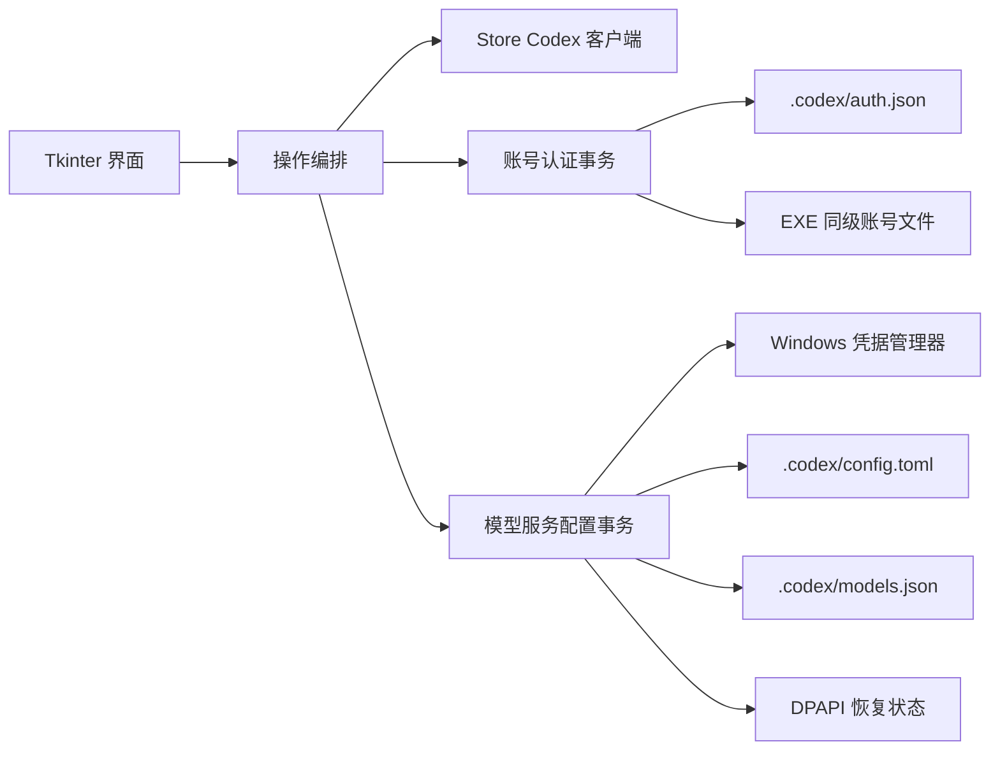

# 架构与安全边界

## 设计目标

Codex 切换器是单机 Windows 应用。设计优先级依次为：不泄露凭据、不破坏现有 Codex 配置、失败可回滚、用户操作明确、打包后无需 Python 环境。

## 模块职责

| 模块 | 职责 | 不负责 |
| --- | --- | --- |
| `app.py` | Tkinter 界面、状态展示、后台任务和用户确认 | 直接实现磁盘事务或 Win32 底层调用 |
| `account_store.py` | 认证文件校验、账号清单、原子复制、备份和回滚 | 解析认证语义或联网验证账号 |
| `provider_config.py` | DeepSeek 配置激活、冲突检测、恢复状态和多文件回滚 | 保存 API Key 的长期明文副本 |
| `credential_store.py` | Windows 凭据管理器和 DPAPI | 管理 Codex 账号认证文件 |
| `codex_client.py` | 识别、关闭和启动 Microsoft Store 版 Codex | 操作其他 Codex 安装或无关进程 |
| `tools/repository_check.py` | 提交前的仓库内容、安全和完整性检查 | 替代 GitHub Secret Scanning 或密钥轮换 |

## 核心流程

### 切换 OpenAI 账号

1. 校验目标认证副本与保存时的 SHA-256 是否一致。
2. 请求 Microsoft Store 版 Codex 退出；必要时仅终止匹配 Store 包路径的进程。
3. 备份当前 `auth.json`，通过同目录临时文件原子替换。
4. 验证目标文件哈希并重新启动 Codex。
5. 若账号替换失败，恢复原认证并尝试重新启动客户端。

当 DeepSeek 正在使用时，流程会先恢复 OpenAI 受管配置，再替换账号；任一步失败都会按已完成阶段执行补偿。

### 切换到 DeepSeek

1. 从 Windows 凭据管理器读取并校验 API Key。
2. 读取现有 `config.toml` 和 `models.json`，拒绝过大、非法 UTF-8 或非法 TOML/JSON。
3. 将恢复基线使用当前 Windows 用户的 DPAPI 加密后写入 `provider_state.dat`。
4. 生成仅包含官方要求字段的配置变更，并写入固定哈希的模型目录。
5. 任一文件写入失败时恢复全部原值；成功后重新启动 Codex。

### 切回 OpenAI

应用对当前受管字段和模型目录计算语义指纹。如果这些内容被外部程序修改，应用停止恢复并提示冲突，不会猜测或覆盖。验证通过后，仅恢复本应用接管的字段，并保留切换后新增的 MCP、插件、项目配置等非受管内容。

## 数据与信任边界

- `auth.json` 和账号副本属于高敏感凭据；应用只做结构、大小和哈希校验，不解释或上报其内容。
- DeepSeek API Key 的持久存储由 Windows 凭据管理器负责；使用 DeepSeek 期间，Codex 官方配置仍需要在 `config.toml` 中读取该值。
- `provider_state.dat` 只用于同一 Windows 用户恢复配置，不能跨用户或跨设备解密。
- 模型目录来自固定的官方快照并由 SHA-256 约束；更换快照必须同步更新来源说明、常量和测试。
- 应用没有遥测、更新检查或后台网络请求。

## 兼容性约束

- 目标平台为 Windows 10/11 64 位。
- 自动重启边界只匹配 Microsoft Store 包路径和固定 AUMID。
- 账号存储格式向后兼容 v1.0.x 至 v1.2.x；缺少 `updated_at` 的旧记录在读取时迁移。
- 代码保持 Python 3.8 语法兼容，PyInstaller 生成单文件 GUI 应用。
