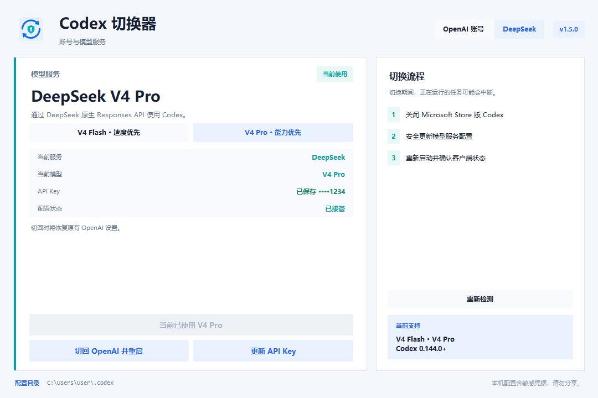

# 使用指南

## OpenAI 账号

### 添加当前账号

1. 打开“OpenAI 账号”。
2. 点击“从当前 Codex 添加”。
3. 输入用于本机识别的备注并保存。

程序读取 `%USERPROFILE%\.codex\auth.json`，校验后将副本保存到 EXE 同级“账号文件”目录。备注不会写入认证文件。

如果当前文件与已保存记录属于同一 ChatGPT 账号，即使 Codex 已刷新令牌并改变了文件内容，也不会创建重复记录。

### 手动选择认证文件

1. 点击“选择 auth.json”。
2. 从文件选择器中选择有效的 UTF-8 JSON 文件。
3. 输入备注并保存。

文件选择器默认打开当前用户的 `.codex` 目录。重复内容不会再次创建账号记录。

### 切换账号

1. 在账号列表中选择目标账号。
2. 点击“切换账号并重启”。
3. 确认正在运行的 Codex 任务可以中断。

程序会按以下顺序处理：

1. 关闭 Microsoft Store 版 Codex，确保它不再写入认证文件。
2. 在跨进程切换锁内，使用不包含令牌内容的账号身份指纹识别当前 ChatGPT 账号。
3. 如果 Codex 已刷新当前 `auth.json`，以原副本哈希为预期旧版本，备份并复检后把最新文件自动保存到对应账号。
4. 备份并复检当前认证文件，再替换为目标账号的 `auth.json`。
5. 重新启动并确认客户端状态，然后释放切换锁。

自动启动失败时，已成功完成的认证切换会保留，界面会提示手动启动 Codex。自动保存成功时，结果提示会标明已更新的账号；即使后续目标账号切换或 OpenAI 配置恢复失败，列表也会刷新为已保存的新哈希，并明确说明目标切换未完成。

账号副本和清单的导入、更新、移除、改备注或修复会先创建 DPAPI 加密的账号存储事务日志。若程序硬退出，下次打开账号存储时会先确认已完成的提交或恢复仍属于本次事务的部分写入；检测到第三方内容时不会覆盖。当前 `auth.json`、模型服务配置和 Codex 进程属于独立边界，因此极端情况下可能停在最后一个已完成阶段；重新打开并按界面真实状态重试目标操作即可，不要手动删除日志。

自动保存要求账号身份唯一匹配且原副本仍与账号清单中的 SHA-256 一致。如果同一 ChatGPT 身份已有多个旧记录，或对应副本在程序外被修改，程序会停止切换，避免把最新令牌写错位置。处理重复或异常记录后再重试。

### 更新、修改备注和移除

- “从当前 Codex 更新”会用当前 `.codex\auth.json` 替换所选账号的旧副本，并保留更新备份。若当前登录是另一个 ChatGPT 账号、在 ChatGPT 与 API Key 认证之间跨模式覆盖，或旧 ChatGPT 副本缺少足以确认同一账号的身份字段，程序会拒绝更新；请把当前认证添加为新账号。
- “修改备注”只更改本地显示名称。
- “移除”删除所选账号的本地副本和清单记录，不修改当前 `.codex\auth.json`。

如果保存的认证副本在程序外被修改，应用会停止切换并提示重新添加或更新，避免使用来源不明的内容。

### 自动同步的边界

- ChatGPT 登录令牌仍由 Codex 官方客户端刷新；本程序不会调用或模拟 OAuth 刷新接口。
- 本程序不按固定天数定时运行。只要通过本工具执行下一次账号切换，Codex 已写回的最新认证就会在覆盖前保存。
- 自动匹配只适用于包含 `auth_mode: "chatgpt"` 与 `tokens.account_id` 的 Codex 托管认证。身份值只在内存中做不可逆指纹比较，不写入清单、日志或界面。
- 自动同步以 Codex 实际写回 `.codex\auth.json` 为前提。若 Codex 被配置为只使用操作系统凭据存储，本程序无法读取或同步未写入该文件的更新。
- 旧格式和 API Key 认证继续支持读取、添加和切换，但不执行 ChatGPT 自动同步。两个都不属于可识别 ChatGPT 身份的普通旧格式仍可手动更新；一旦任一侧是 ChatGPT 且无法确认同一身份，必须重新添加，不能跨模式或猜测覆盖。
- 刷新令牌被撤销、真正过期，或遇到 MFA、密码、安全设置、组织权限等变化时，仍需按 Codex 提示重新登录。

## DeepSeek

### 支持的模型与版本

DeepSeek 接入要求 Codex 0.144.0 或更高版本。当前只开放官方精确 slug：

- V4 Flash：`deepseek-v4-flash`，适合速度优先的任务，也是从 OpenAI 首次进入页面时的默认选项。
- V4 Pro：`deepseek-v4-pro`，适合能力优先的复杂任务。

本程序接管任一模型时都会设置 `model_reasoning_effort = "max"`，让 Flash 和 Pro 使用一致的最高推理档位。这是本程序的配置策略，不是 DeepSeek 官方对 Codex 集成的强制要求；切回 OpenAI 时会恢复进入 DeepSeek 前对应字段的原值或缺失状态。

页面中的“所选模型”用于下一次切换，“当前模型”表示 `config.toml` 中实际生效的模型；选择按钮本身不会修改配置或重启 Codex。应用启动时如果已经处于受支持的 DeepSeek 模式，会用当前实际模型同步选择器。

### 从 OpenAI 切换到 DeepSeek

1. 打开“DeepSeek”。
2. 选择“V4 Flash · 速度优先”或“V4 Pro · 能力优先”。
3. 点击“设置 API Key”，输入以 `sk-` 开头的 DeepSeek API Key。
4. 点击“切换到 V4 Flash 并重启”或“切换到 V4 Pro 并重启”。
5. 确认切换并等待 Codex 重新启动。

API Key 保存在按当前 `CODEX_HOME` 隔离的 Windows 凭据目标中；界面只显示末四位。切换期间，程序按官方要求更新 `CODEX_HOME\config.toml` 和 `models.json`，并以当前 Windows 用户的 DPAPI 保护 OpenAI 恢复基线。

模型服务切换与账号切换共用同一跨进程 Codex 操作锁；另一个实例正在执行任一切换时，本次操作会等待或在停止客户端前安全退出。在锁内，恢复状态、`models.json` 和 `config.toml` 都会先比较预期旧内容再写入。提交前，程序还会在 `CODEX_HOME` 创建 DPAPI 加密的全局事务日志；写入失败或进程硬退出后，下次状态读取、激活或恢复会先处理该日志，再判断当前模型服务。

恢复规则是：全部目标都已经是新内容时确认事务完成；只有部分目标写入时回滚仍属于本事务的内容；如果某个目标既不是事务前内容也不是事务后内容，则视为第三方较新修改，停止自动恢复、保留日志且不覆盖该内容。

如果配置已成功但 Codex 未能自动启动，所选模型仍然已经生效；按提示手动启动 Codex 即可。

### 在 V4 Flash 与 V4 Pro 之间切换

DeepSeek 正在使用时，选择另一个模型并点击切换按钮。程序会重新确认当前实际模型和恢复状态，关闭 Codex，安全更新模型配置，再重新启动。V4 Flash 与 V4 Pro 可以双向切换，整个 DeepSeek 会话始终保留最初进入时保存的 OpenAI 恢复基线。

当前实际模型与所选模型相同时，切换按钮会显示“当前已使用”，不会执行无意义的重写或重启。

### 更新或移除 API Key

- 在 OpenAI 模式下，可通过 API Key 编辑窗口更新或移除保存的密钥。
- 在 DeepSeek 模式下更新密钥会在操作锁内重新确认并保持当前实际模型，然后同步更新受管配置并重启 Codex；界面中尚未应用的另一个模型选项不会改变此次结果，原 OpenAI 恢复基线也不会变化。
- 移除密钥前必须先切回 OpenAI，避免当前 DeepSeek 配置失去认证。

保存凭据和活动配置属于两个不同的 Windows 存储边界。若应用在两者之间硬退出，重新打开时会先恢复文件事务并对账：当 DeepSeek 配置由本程序管理且没有冲突时，`config.toml` 中经过校验的活动 API Key 是 Codex 实际使用值和对账权威；OpenAI 模式下保存的 API Key 只是下一次切换使用的偏好值。

### 切回 OpenAI

点击“切回 OpenAI 并重启”。应用只恢复自己接管的配置字段，保留切换后新增的 MCP、插件、项目配置等其他设置。

如果受管字段、`models.json`、`provider_state.dat` 或全局事务日志已被外部程序修改，应用会停止覆盖并提示配置冲突。请先备份当前 `.codex` 和程序数据目录、确认修改来源；不要直接删除 `provider_state.dat` 或事务日志，否则可能失去安全恢复基线和事务归属证据。

如果检测到未知或不受支持的 DeepSeek 模型，应用不会猜测模型名称，也不允许切换模型或更新 API Key。只有找到可信的 OpenAI 配置备份时，“切回 OpenAI 并重启”才可用。

### 在 DeepSeek 模式下切换 OpenAI 账号

直接返回“OpenAI 账号”页并选择账号。程序会一次完成：关闭 Codex、恢复 OpenAI 配置、替换账号认证、重新启动。任一步失败时会按已完成阶段回滚。

### v1.4 API Key 迁移

v1.4 把 DeepSeek API Key 保存到一个全局 Windows 凭据目标；v1.5 按规范化 `CODEX_HOME` 派生独立目标，避免多个 Codex home 互相复用密钥。

- 使用规范默认 `%USERPROFILE%\.codex` 时，程序会把 v1.4 全局凭据复制到该 home 的独立目标、复读验证，再写入独立迁移标记。Windows 凭据管理器没有原子“比较并删除”，因此旧全局目标会保留以兼容降级；迁移标记保证用户后来删除 scoped 凭据时不会把旧值再次导入。
- 使用自定义 `CODEX_HOME` 时，程序不会认领或删除可能属于默认 home 的 v1.4 全局凭据。只有当前配置是本程序受管、无冲突的活动 DeepSeek 配置时，才会从该配置中的实际 API Key 对账到自定义 home 的凭据目标。
- 如果自定义 home 当前是 OpenAI 且没有自己的已保存密钥，需要重新设置一次 API Key。

### 硬退出与不同便携副本

全局事务日志位于 `CODEX_HOME`，其中绑定了创建事务时使用的 `provider_state.dat` 绝对路径。因此，不同便携副本即使共享同一 `CODEX_HOME`，也不会让另一份程序数据目录冒充原恢复状态。

如果页面提示事务日志属于另一份程序数据目录：

1. 退出所有 Codex 切换器实例。
2. 备份当前 `CODEX_HOME`、原便携副本和当前便携副本的“账号文件”目录。
3. 返回创建该事务的原始便携副本并重新打开程序，让它在共享锁内完成恢复。
4. 不要手动删除 `.codex-account-switcher-provider-transaction.dat` 或 `provider_state.dat`。
5. 如果原始副本已丢失或无法确认路径，保留现场，通过仓库的私密安全公告联系维护者；报告前去除 API Key、用户名和完整本机路径。

## 本机数据

EXE 同级“账号文件”目录可能包含：

- `profiles.json`：账号备注、文件索引和校验值。
- `auth_<账号ID>.json`：认证副本。
- `切换备份`、`更新备份`：操作前备份；自动保存刷新认证也使用“更新备份”。
- `provider_state.dat`：DPAPI 加密的模型服务恢复状态。
- `.profiles.lock`：账号存储的跨进程锁，不包含凭据；程序运行时不要删除。
- `.codex-account-switcher-account-transaction.dat`：账号副本/清单事务尚未确认完成时存在的 DPAPI 加密日志，绑定当前“账号文件”目录；不要上传、移动或手动删除。

目标 `CODEX_HOME` 目录还会保留：

- `.codex-account-switcher.lock`：串行化完整账号切换、模型服务切换和恢复；不包含凭据。
- `.codex-account-switcher-provider-transaction.dat`：仅在模型服务事务尚未确认完成时存在的 DPAPI 加密全局日志，可能包含受保护的原始配置和恢复定位信息。

Windows 凭据管理器中的 DeepSeek API Key 目标也按 `CODEX_HOME` 隔离。它不在程序目录中，但仍属于敏感本机数据。

这些文件均可能包含敏感信息。不要上传到 GitHub、网盘、聊天工具或公共日志；不要把整个程序目录交给他人。迁移设备时，应在目标设备重新添加账号和 API Key，不要依赖 DPAPI 状态文件跨设备恢复。

## 常见提示

### 未检测到 Microsoft Store 版 Codex

自动重启只支持 Microsoft Store 版。切换已成功时可手动启动 Codex；其他安装方式不在自动重启范围内。

### 认证文件无效

确认文件存在、大小不超过 10 MB、采用 UTF-8 编码、JSON 顶层为对象，且未被其他程序截断或替换。

### 多个账号副本具有同一 ChatGPT 身份

表示旧版本或外部操作留下了同一账号的多个认证副本。为避免自动更新错记录，程序不会猜测。确认需要保留的账号，移除重复记录；如果备注不足以判断，可先在安全位置备份整个“账号文件”目录。

### 当前认证与所选账号不是同一 ChatGPT 账号

表示“从当前 Codex 更新”选错了账号项。不要强行覆盖；返回账号列表选择正确记录，或将当前认证添加为新账号。

旧 ChatGPT 文件没有 `tokens.account_id` 时，程序同样无法证明变化后的认证仍属于原账号。此时先确认当前登录正确，移除无法确认的旧记录，再从当前 Codex 重新添加。

### 等待 Codex 操作锁超时

表示另一个 Codex 切换器实例正在操作，或上一次实例仍未完全退出。等待另一个实例完成后重试；锁文件是持久占位文件，不需要也不应手动删除。

### 配置冲突

表示 DeepSeek 激活后受管字段或模型目录被外部程序修改。先备份当前 `.codex` 目录，再确认修改来源；不要强行覆盖。

### 配置事务日志损坏或属于另一份程序目录

表示上一次模型服务操作没有完成收尾，或当前便携副本不是创建日志的副本。程序会失败关闭，不会猜测路径或覆盖第三方内容。先备份 `CODEX_HOME` 和相关“账号文件”目录，再返回原始便携副本恢复；不要手动删除事务日志或 `provider_state.dat`。无法确认原始副本时，请按安全策略通过私密渠道联系维护者。

### 账号存储事务日志损坏或属于另一份账号目录

表示上一次账号副本/清单变更没有完成收尾，日志无法由当前 Windows 用户解密，或程序数据目录与日志记录不一致。程序会停止账号存储操作并保留现场。先备份当前程序的“账号文件”目录，不要删除 `.codex-account-switcher-account-transaction.dat`、`profiles.json` 或认证副本；返回原始便携副本重试。无法确认来源时，通过私密安全渠道联系维护者，切勿上传原始文件。

### 当前 DeepSeek 模型未知或不受支持

表示 `config.toml` 中的实际模型不是 `deepseek-v4-flash` 或 `deepseek-v4-pro`，或缺少模型字段。程序不会猜测、改写模型或更新密钥；如果页面仍提供“切回 OpenAI 并重启”，说明已找到可信恢复基线，可先安全恢复 OpenAI。没有该按钮时，请先备份 `.codex` 目录并人工确认配置来源。

### Windows 安全提示

当前 EXE 未使用商业代码签名证书。请只使用可信来源的发布包，并先核对同目录 `SHA256.txt` 或 ZIP 的 `.sha256.txt` 文件。
